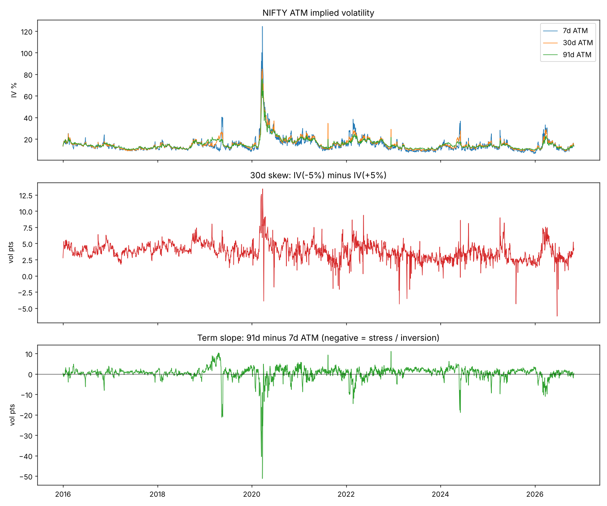

# NeuraVol Forecast: Neural Volatility Surface Forecaster (NIFTY)

Rebuilds the NIFTY 50 implied-volatility surface every trading day from NSE data (2016-2026) and forecasts it
1, 5 and 20 trading days ahead with a GRU network on PCA surface factors, tested walk-forward against honest
baselines and a delta-hedged options backtest. Includes a Streamlit dashboard and a daily update pipeline.



**Quick start (dashboard):**
```
pip install -r requirements.txt
streamlit run app.py
```
Deployment and daily updates: see [DEPLOY.md](DEPLOY.md).

## Pipeline

| Step | Command | Output |
|---|---|---|
| 1. Download + merge NSE F&O bhavcopies | `python download_bhavcopy.py --start 2016-01-01` | `data/raw/*.zip`, `data/processed/fo_index.parquet` |
| 2. Build one IV surface per day | `python build_surfaces.py` | `data/surfaces/NIFTY_grid.npz`, slices, diagnostics |
| 3. Sanity-check plots | `python make_plots.py` | `reports/*.png` |
| 4. Baselines (random walk, PCA-VAR) | `python evaluate_baselines.py` | `reports/baselines_NIFTY.json` |
| 5. Neural model (Google Colab, GPU) | `notebooks/NeuraVol_v2_Colab.ipynb` | `models/neuravol_v2.pt`, `reports/nn_v2/` |
| 6. Trading backtest | `python backtest.py` | `reports/backtest/` |
| 7. Track record for the app | `python build_track_record.py` | `data/track_record/` |
| 8. Website | `streamlit run app.py` | see `DEPLOY.md` |
| Daily refresh | `python daily_update.py` | new surface + forecast |
| tests | `python tests/test_pricing.py` | |

## Results (walk-forward 2020-2026, RMSE in vol points)

| Horizon | No change | PCA-VAR | NeuraVol (NN v2 + PCA-VAR) |
|---|---|---|---|
| 1 day | 1.83 | 2.05 | **1.82** |
| 5 days | 3.58 | 3.61 | **3.48** |
| 20 days | 6.88 | 6.12 | **6.02** |

Lowest error at every horizon, but not statistically significant vs "no change" (Diebold-Mariano p = 0.54 / 0.45 / 0.12).
A delta-hedged straddle backtest shows no trading profit after costs (see `reports/backtest/`).

## How a surface is built (`src/surface.py`)

1. Keep option contracts that actually traded that day.
2. Forward price per expiry from put-call parity (fallback: futures close). No dividend assumptions needed.
3. Keep out-of-the-money options only; Black-76 implied vol (`src/pricing.py`).
4. Fit a raw-SVI smile to each expiry; drop smiles whose fit error is above 15% of ATM vol.
5. Enforce calendar no-arbitrage (total variance non-decreasing in maturity); check butterfly arbitrage (Durrleman condition).
6. Interpolate total variance onto a fixed grid: tenors 7/14/30/60/91/182/365 days x log-moneyness -15%..+15%.
   A `mask` marks grid cells backed by real quotes; models are scored on masked cells only.

## Notes / known approximations

- Risk-free rate: RBI repo-rate proxy in `src/config.py`. Drop a `data/rates.csv` (`date,rate`) of 91-day T-bill yields to override.
- Pre-July-2024 bhavcopies have no spot column; the forward is implied from options, so this does not matter for IV.
- Very few strikes traded in 2016-2017, so early surfaces are coarser.

## Model in one paragraph

Each day the surface (7 maturities x 9 moneyness levels) is compressed into 8 PCA factors. A GRU reads the last 20 days
of factors, NIFTY returns, realised volatility and an event calendar (Union Budget, election results, expiry week) and
predicts the change of every factor at all three horizons at once. Training uses a Huber loss on spike-filtered targets
plus a calendar no-arbitrage penalty; a 5-seed ensemble's prediction is shrunk toward "no change" by a factor chosen on
validation data, and the published forecast averages it with a PCA-VAR model.

*Research and education only. Not investment advice and not buy/sell recommendations.*
